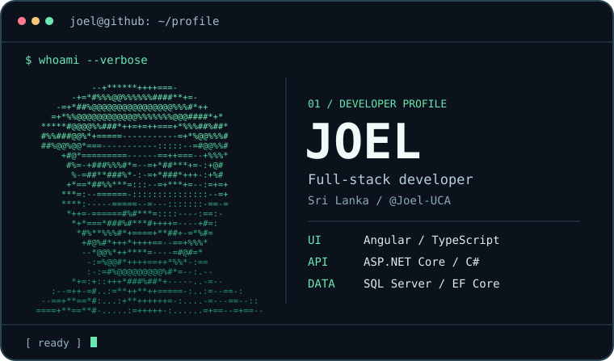

# Hey dev, I’m Joel 👋

I’m a full-stack developer from Sri Lanka. I enjoy making complicated workflows easier to use, from designing the Angular interface to following a request through the .NET API and into SQL Server.

**[Portfolio](https://github.com/Joel-UCA/portfolio)** · **[Public repositories](https://github.com/Joel-UCA?tab=repositories)**

## `$ ls ~/projects`

| Project | What I built |
| --- | --- |
| **💬 Pod AI Chatbot** | A reusable Angular chat widget with an animated assistant, a responsive chat window, and an API integration. [Frontend](https://github.com/Joel-UCA/AI-ChatBot-Front-End) · [Backend](https://github.com/Joel-UCA/AI-ChatBot-Back-End) |
| **🎓 IT Institute Course Management System** | Separate dashboards for students and admins. Students enroll and view fees, while admins manage enrollments, record payments, and generate reports. |

## `$ cat ~/interests.txt`

I like figuring out what happens between a button click and a database write. Away from the browser, I’m curious about electronics and how things work under the hood.
